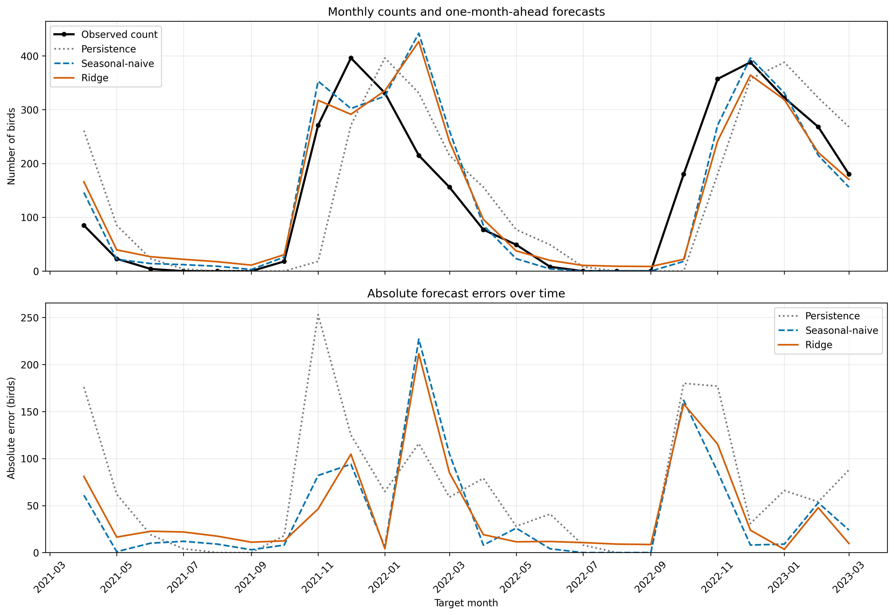
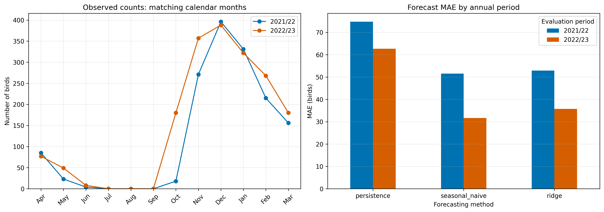

# DS-A5 | Black-faced Spoonbill Forecasting

**Name:** Kseniia Mamushkina  
**Student ID:** 2026A8010351001  
**Course:** Data Science  
**Assignment:** DS-A5 — Time-Series Rolling Evaluation Lab

## Research question

How accurately can next-month counts of Black-faced Spoonbills
(*Platalea minor*) in Deep Bay, southern China, be predicted using
previous monthly counts?

Deep Bay, also known as Shenzhen Bay, lies between northwestern
Hong Kong and Shenzhen. The intended stakeholders are wetland
managers and the waterbird monitoring team.

The proposed scenario involves forecasting the following month's
survey count at each month-end. The intended stakeholders are wetland
managers and the waterbird monitoring team.

## Data and provenance

The dataset contains **60 consecutive monthly observations from
April 2018 to March 2023**.

Counts were compiled from ten summer and winter reports of the
**Mai Po Inner Deep Bay Ramsar Site Waterbird Monitoring Programme**,
prepared by the Hong Kong Bird Watching Society (HKBWS) for the
Agriculture, Fisheries and Conservation Department (AFCD),
Hong Kong SAR Government.

Official source archives:

- [Summer reports](https://cms.hkbws.org.hk/cms/en/component/phocadownload/category/14-research-report/15-mai-po-inner-deep-bay-ramsar-site-waterbird-monitoring-programme/24-reports-of-monthly-waterbird-monitoring/27-wmp-summer-report?Itemid=674):
  reports used for 2018–2022.
- [Winter reports](https://cms.hkbws.org.hk/cms/en/component/phocadownload/category/14-research-report/15-mai-po-inner-deep-bay-ramsar-site-waterbird-monitoring-programme/24-reports-of-monthly-waterbird-monitoring/26-wmp-winter-report?Itemid=674):
  reports used for 2018/19–2022/23.

The CSV is a derived dataset assembled from report tables. Each row retains
the source report, page number, and URL.

All 60 extracted values were checked against the reports,
and the student independently checked a subset.
Validation found no missing or duplicate months.
Counts range from 0 to 442 and include seven confirmed zeros.
A zero indicates that no birds were recorded, rather than
proving their complete absence.

**Input CSV SHA-256:**

`4094b12afb2722e1690d39e62d95221aaef6f1154db615dfb26635402274de27`

## Information availability and predictors

Each monthly count is assumed to be available internally by the
end of its observation month. Published counts serve as proxies
for those internal records; historical release dates and revision
histories were not verified.

For a forecast issued at the end of month t:

| Variable | Definition | Assumed availability |
|---|---|---|
| `lag_1` | Count in month t | End of month t |
| `lag_12` | Count in month t−11: the target month one year earlier | End of month t−11 |
| Target | Survey count in month t+1 | End of month t+1; unavailable when forecasting |

## Models and rolling evaluation

Three methods are evaluated on identical forecast months:

1. **Persistence:** predict the latest monthly count.
2. **Seasonal-naive:** predict the count from the same month
   of the previous year.
3. **Ridge regression:** combine `lag_1` and `lag_12`,
   with fixed alpha = 1.0 and solver = `svd`.

Constructing the annual lag leaves **48 complete examples**
from April 2019 to March 2023.

Evaluation uses a one-month horizon and expanding training windows:

- Initial training: 24 examples, April 2019–March 2021.
- Evaluated target months: April 2021–March 2023.
- Number of forecasts per method: 24.
- Training size: increases from 24 to 47 examples.

A fresh StandardScaler–Ridge pipeline is fitted inside each
training window. Temporal assertions check information
availability and exclude the forecast month's outcome
from training.

Negative Ridge predictions would be clipped to zero.
None occurred. Predictions are not rounded before evaluation.

**MAE** is the primary metric; **RMSE** is the secondary metric.
Both metrics quantify errors in the predicted number of birds, with lower values indicating
better performance. Percentage errors are avoided because
observations include zeros.

## Results

| Method | Forecasts | MAE | RMSE |
|---|---:|---:|---:|
| Persistence | 24 | 68.71 | 96.78 |
| Seasonal-naive | 24 | **41.58** | 70.77 |
| Ridge | 24 | 44.31 | **69.42** |

Seasonal-naive achieved the lowest MAE and retained this advantage
in both annual evaluation periods. Ridge had a slightly lower
overall RMSE, but combining the two lagged predictors did not
improve the primary metric.

Persistence struggled during rapid seasonal changes.
Seasonal-naive and Ridge also made substantial errors when
monthly counts departed from the previous year's pattern.
Ridge was the least accurate method in summer.



All three methods had lower MAE in the second annual period.
Ridge's improvement cannot be attributed solely to additional
training examples, because the baselines improved without
fitting parameters.



## Monitoring and fallback

Seasonal-naive is the proposed default for further evaluation,
with Ridge running in parallel as a candidate model.

The proposed plan includes monthly data validation, recording
forecasts before outcomes become available, tracking errors,
and comparing the latest 12-month MAE with the preceding
12-month MAE.

If the annual lag is unavailable, persistence may be used
temporarily when the latest count is valid. If neither input
is available, the automated forecast should be withheld for
manual review. Changes in survey coverage or methodology
require a comparability review.

Ridge and its scaler should be refitted after each new valid
observation. The monitoring and fallback rules have not been
tested as an operational system.

## Repository contents

| File or folder | Description |
|---|---|
| [Analysis notebook](DS_A5_black_faced_spoonbill_forecasting.ipynb) | Code, explanations, assertions, and saved outputs |
| [PDF report](DS_A5_black_faced_spoonbill_report.pdf) | Written account of methods, results, and limitations |
| [Input CSV](deepbay_black_faced_spoonbill_monthly_2018_2023.csv) | Monthly counts with source references |
| [tables/](tables/) | Training examples, rolling schedule, forecasts, metrics, and diagnostic tables |
| [figures/](figures/) | Forecast and temporal-diagnostic plots in PNG and PDF |
| [requirements.txt](requirements.txt) | Recorded package versions and environment information |
| [AI_USE_LOG.md](AI_USE_LOG.md) | AI assistance, decisions, corrections, and verification |

## Reproduction

The notebook is designed for **Google Colab**.

1. Download the notebook, input CSV, and `requirements.txt`.
2. Open the notebook in Colab.
3. To match the recorded package versions, upload
   `requirements.txt` through the Files panel and run the
   following in a setup cell before the analysis:

   ```python
   %pip install -r /content/requirements.txt
   ```

4. Restart the runtime if requested.
5. Run the analysis cells from top to bottom.
6. At the CSV upload prompt, select only the input dataset.
7. Confirm that validation passes before continuing.

The recorded Colab environment used **Python 3.13.18**
and **scikit-learn 1.6.1**. Full recorded package versions
are listed in `requirements.txt`. Its comments document
Python and the platform; installing the file does not
change the Python version or operating system.

The notebook verifies the input CSV against its expected
SHA-256 hash. No random split or stochastic solver is used.

## Limitations

- Only 60 monthly observations and 24 evaluated forecasts
  are available.
- The target is a recorded survey count; detectability,
  bird movements, survey conditions, and coverage can affect it.
- Internal month-end availability is assumed.
- Only two lagged predictors and one fixed Ridge configuration
  were tested.
- Results do not establish a statistically reliable performance
  difference, persistent temporal drift, or biological causes
  of changes in counts.
